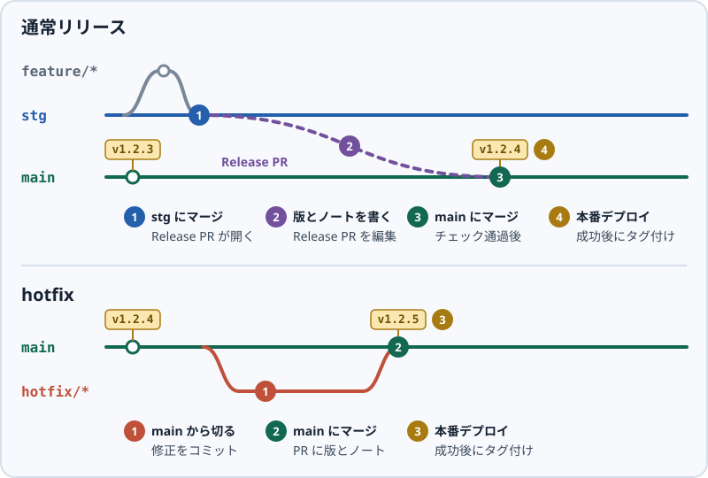

# release-flow

[](https://github.com/9wick/release-flow/actions/workflows/ci.yml)

[English](README.md) | 日本語

**release-flow** は、`stg` に入った変更を Release PR で確認し、`main` にマージして本番へリリースするための GitHub Actions です。版更新用のコミットを作らずに運用できます。

次に出る変更は Release PR に自動でまとまり、リリースする版とリリースノートは人が PR のタイトルと本文で決めます。デプロイ処理自体は各リポジトリの workflow で行います。

## アクション一覧

| アクション | 役割 |
| --- | --- |
| [`9wick/release-flow/release-pr`](release-pr/action.yml) | `stg` から `main` への Release PR を開き、`stg` が進むたびに変更一覧を更新します。 |
| [`9wick/release-flow/check`](check/action.yml) | PR タイトルの版と本文のリリースノート欄を検証し、未入力の初期値を補います。 |
| [`9wick/release-flow/resolve`](resolve/action.yml) | デプロイ先環境（`prod` / `stg` / `dev`）、`version`、`tag`、`sha`、`notes` を出力します。 |

## リリースの流れ



1. **開発ブランチの PR を `stg` にマージする。** `stg` へのマージでステージングにデプロイされ、`stg` から `main` へのドラフト Release PR が開きます。Release PR を開いたまま `stg` に変更を積むと、同じ PR の変更一覧が更新されます。
2. **リリース準備を整える。** 本番に出すと決めたら、PR タイトルの版（例: 前回が `1.2.3` なら初期値は `1.2.4`、minor/major なら `1.3.0` や `2.0.0` に変更）を確認し、**Release Notes** 見出しの下、`<!-- release-flow:notes -->` 内に利用者向けの変更を書きます。

   ```markdown
   ## Release Notes
   > Edit before merging. The text below becomes the release notes for this version.

   <!-- release-flow:notes -->
   同期の完了までにかかる時間を短縮しました。
   <!-- /release-flow:notes -->
   ```

3. **ドラフトを解除して `main` にマージする。** `Release version and notes` チェックが通ったら、`stg` の履歴を取り込むため **Create a merge commit** で `main` にマージします。
4. **本番デプロイと記録。** `main` へのマージで本番デプロイが始まり、成功後に例では `v1.2.4` のようなタグと GitHub Release を作ります。次のリリースはこのタグを基に版が提案されます。

**hotfix の場合:** `main` から修正ブランチを切って `main` 宛ての PR を開き、タイトルに版・本文にリリースノートを書いてマージします。リリース後、`main` から `stg` へ PR を出して修正を取り込みます。

## クイックスタート

本番ブランチが `main`、ステージングブランチが `stg` のリポジトリ向けの導入手順です。

### 1. リポジトリを設定する

- **Settings → Actions → General → Workflow permissions** で **Allow GitHub Actions to create and approve pull requests** を有効にします。
- `main` への変更は PR 経由にし、`main` 宛ての PR で **マージコミット** を許可します。

### 2. workflow を配置する

以下の3ファイルを `.github/workflows/` に置きます（[`examples/`](examples/) にも同じファイルがあります）。

- **`stg` が進んだら Release PR を更新する**:

```yaml
# .github/workflows/release-pr.yml
name: Release PR
on:
  push:
    branches: [stg]
permissions:
  contents: write # the release notes API requires it
  pull-requests: write
concurrency:
  group: release-pr
  cancel-in-progress: true
jobs:
  release-pr:
    runs-on: ubuntu-latest
    timeout-minutes: 5
    steps:
      - uses: 9wick/release-flow/release-pr@v1
```

- **ドラフト解除後に `main` 宛ての PR を検証する**:

```yaml
# .github/workflows/release-check.yml
name: Release check
on:
  pull_request:
    types: [opened, edited, reopened, synchronize, ready_for_review]
    branches: [main]
permissions:
  contents: read
  pull-requests: write # to fill in the defaults when a PR opens or leaves draft
concurrency:
  group: release-check-${{ github.event.pull_request.number }}
  cancel-in-progress: true
jobs:
  check:
    name: Release version and notes
    # People are still writing while the PR is a draft
    if: ${{ !github.event.pull_request.draft }}
    runs-on: ubuntu-latest
    timeout-minutes: 5
    steps:
      - uses: 9wick/release-flow/check@v1
```

- **デプロイ情報を解決してデプロイする**（`stg` への push でステージング、`main` 宛て PR のマージで本番デプロイと GitHub Release 作成を実行）。`./scripts/deploy.sh` はご自身のデプロイ手順に置き換えてください:

```yaml
# .github/workflows/deploy.yml
name: Deploy
on:
  push:
    branches: [stg]
  pull_request:
    types: [closed]
    branches: [main]
permissions:
  contents: write # to tag staging versions and record the prod release
concurrency:
  group: deploy-${{ github.ref }}
  cancel-in-progress: false
jobs:
  deploy:
    if: ${{ github.event_name == 'push' || github.event.pull_request.merged == true }}
    runs-on: ubuntu-latest
    steps:
      - id: release
        uses: 9wick/release-flow/resolve@v1

      - uses: actions/checkout@3d3c42e5aac5ba805825da76410c181273ba90b1 # v7
        with:
          ref: ${{ steps.release.outputs.sha }}
          persist-credentials: false

      - name: Deploy
        env:
          ENVIRONMENT: ${{ steps.release.outputs.environment }}
          VERSION: ${{ steps.release.outputs.version }}
        run: ./scripts/deploy.sh "$ENVIRONMENT" "$VERSION"

      # The tag is the record of what prod runs, and the next release PR's version builds on it
      - name: Record the prod release
        if: ${{ steps.release.outputs.environment == 'prod' }}
        env:
          GH_TOKEN: ${{ github.token }}
          GH_REPO: ${{ github.repository }}
          TAG: ${{ steps.release.outputs.tag }}
          SHA: ${{ steps.release.outputs.sha }}
          NOTES: ${{ steps.release.outputs.notes }}
        run: gh release view "$TAG" > /dev/null 2>&1 || gh release create "$TAG" --target "$SHA" --title "$TAG" --notes "$NOTES"
```

### 3. 初回のリリースを確認する

- すでに本番を運用している場合は、現在本番で動いているコミットに現在の版のタグ（例 `v1.2.3`）があることを確認し、なければ付けておきます。リリースタグが一つもない場合、初期値は `0.0.1` です。
- `stg` へのマージでステージングデプロイと Release PR 作成が進むことを確認し、初回の `Release version and notes` が成功したら `main` の[必須ステータスチェック](https://docs.github.com/en/pull-requests/how-tos/merge-and-close-pull-requests/troubleshooting-required-status-checks)に追加します。
- Release PR を `main` にマージし、本番デプロイ後にタグと GitHub Release が作られることを確認します。

## ドキュメント

- [設定とアクションリファレンス](docs/reference.ja.md) — PR タイトル・本文の仕様、版の決まり方（`stg` / `dev` プレリリース版）、各アクションの入出力と権限。
- [トラブルシューティング](docs/troubleshooting.ja.md) — よくあるエラーへの対処、`GITHUB_TOKEN` の承認待ち、hotfix との版競合、再実行や fork PR の扱い。
- [開発ガイド](CONTRIBUTING.ja.md) — ローカルでの型チェック・テスト手順。
