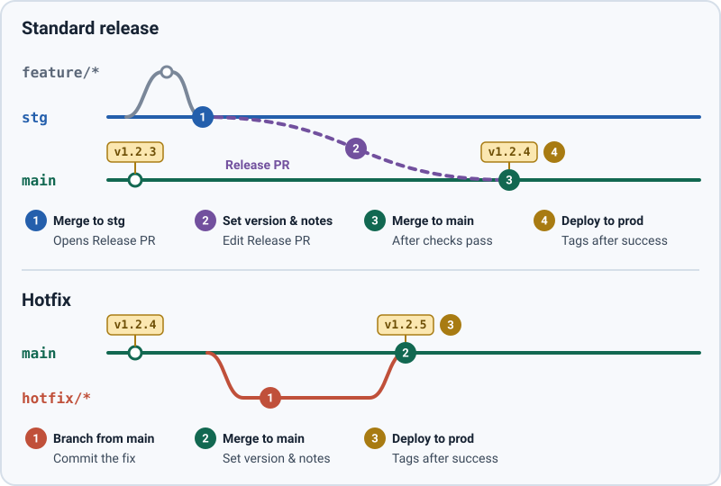

# release-flow

[](https://github.com/9wick/release-flow/actions/workflows/ci.yml)

English | [日本語](README.ja.md)

**release-flow** is a set of composable GitHub Actions for shipping changes from a staging branch (`stg`) to a production branch (`main`) through a single Release PR—without version-bump commits.

Incoming changes are automatically listed in the Release PR, humans decide the version and release notes right in the PR title and description, and your own deploy workflow handles deployment.

## Actions

| Action | Role |
| --- | --- |
| [`9wick/release-flow/release-pr`](release-pr/action.yml) | Keeps a Release PR open from `stg` to `main` and updates its change list as `stg` advances. |
| [`9wick/release-flow/check`](check/action.yml) | Validates the SemVer version in the PR title and the release notes section in the PR description. |
| [`9wick/release-flow/resolve`](resolve/action.yml) | Outputs target `environment` (`prod`, `stg`, or `dev`), `version`, `tag`, `sha`, and `notes` for deploy jobs. |

## How It Works



1. **Merge feature PRs into `stg`.** Merging to `stg` deploys to staging and opens a draft Release PR from `stg` to `main` listing the PRs since the last release. Subsequent merges to `stg` keep updating the same Release PR.
2. **Prepare the release.** When you are ready to ship, review the PR title (defaulting to the next patch, e.g., `1.2.4` after `1.2.3`; change it to `1.3.0` or `2.0.0` for minor/major bumps) and write user-facing notes inside `<!-- release-flow:notes -->`:

   ```markdown
   <!-- release-flow:notes -->
   Reduced sync completion time.
   <!-- /release-flow:notes -->
   ```

3. **Mark ready and merge to `main`.** Take the PR out of draft, wait for the `Release version and notes` check to pass, and merge into `main` using **Create a merge commit** so `stg` history is preserved.
4. **Deploy to production.** Merging to `main` triggers your deploy workflow. After deployment succeeds, the example workflow creates the release tag (e.g., `v1.2.4`) and GitHub Release, which future versions build on.

**Hotfixes:** Branch directly from `main`, open a PR targeting `main` with the version title and release notes, and merge it. Afterward, open and merge a PR from `main` into `stg` to sync the fix back to staging.

## Quickstart

This setup assumes `main` is your production branch and `stg` is your staging branch.

### 1. Configure repository settings

- Under **Settings → Actions → General → Workflow permissions**, enable **Allow GitHub Actions to create and approve pull requests**.
- Require changes to `main` to go through pull requests, and allow **merge commits** on PRs into `main`.

### 2. Add the workflows

Add the following three workflow files under `.github/workflows/` (also available in [`examples/`](examples/)):

- **Keep the Release PR updated** when `stg` advances:

```yaml
# .github/workflows/release-pr.yml
name: Release PR
on:
  push:
    branches: [stg]
permissions:
  contents: write # the release notes API requires it
  pull-requests: write
concurrency:
  group: release-pr
  cancel-in-progress: true
jobs:
  release-pr:
    runs-on: ubuntu-latest
    timeout-minutes: 5
    steps:
      - uses: 9wick/release-flow/release-pr@v1
```

- **Validate PRs targeting `main`** once they leave draft:

```yaml
# .github/workflows/release-check.yml
name: Release check
on:
  pull_request:
    types: [opened, edited, reopened, synchronize, ready_for_review]
    branches: [main]
permissions:
  contents: read
  pull-requests: write # to fill in the defaults when a PR opens or leaves draft
concurrency:
  group: release-check-${{ github.event.pull_request.number }}
  cancel-in-progress: true
jobs:
  check:
    name: Release version and notes
    # People are still writing while the PR is a draft
    if: ${{ !github.event.pull_request.draft }}
    runs-on: ubuntu-latest
    timeout-minutes: 5
    steps:
      - uses: 9wick/release-flow/check@v1
```

- **Resolve release metadata and deploy** (`stg` pushes deploy staging; merged `main` PRs deploy production and create the GitHub Release). Replace `./scripts/deploy.sh` with your deploy command:

```yaml
# .github/workflows/deploy.yml
name: Deploy
on:
  push:
    branches: [stg]
  pull_request:
    types: [closed]
    branches: [main]
permissions:
  contents: write # to tag staging versions and record the prod release
concurrency:
  group: deploy-${{ github.ref }}
  cancel-in-progress: false
jobs:
  deploy:
    if: ${{ github.event_name == 'push' || github.event.pull_request.merged == true }}
    runs-on: ubuntu-latest
    steps:
      - id: release
        uses: 9wick/release-flow/resolve@v1

      - uses: actions/checkout@3d3c42e5aac5ba805825da76410c181273ba90b1 # v7
        with:
          ref: ${{ steps.release.outputs.sha }}
          persist-credentials: false

      - name: Deploy
        env:
          ENVIRONMENT: ${{ steps.release.outputs.environment }}
          VERSION: ${{ steps.release.outputs.version }}
        run: ./scripts/deploy.sh "$ENVIRONMENT" "$VERSION"

      # The tag is the record of what prod runs, and the next release PR's version builds on it
      - name: Record the prod release
        if: ${{ steps.release.outputs.environment == 'prod' }}
        env:
          GH_TOKEN: ${{ github.token }}
          GH_REPO: ${{ github.repository }}
          TAG: ${{ steps.release.outputs.tag }}
          SHA: ${{ steps.release.outputs.sha }}
          NOTES: ${{ steps.release.outputs.notes }}
        run: gh release view "$TAG" > /dev/null 2>&1 || gh release create "$TAG" --target "$SHA" --title "$TAG" --notes "$NOTES"
```

### 3. Verify your first release

- If your repository is already in production, ensure the currently deployed commit has a matching tag (e.g., `v1.2.3`). Without existing release tags, the initial version defaults to `0.0.1`.
- Merge a change into `stg`, confirm staging deploys and a Release PR opens, and add `Release version and notes` as a [required status check](https://docs.github.com/en/pull-requests/how-tos/merge-and-close-pull-requests/troubleshooting-required-status-checks) on `main` once it runs.
- Merge the Release PR into `main` and verify production deploys and creates the tag and GitHub Release.

## Documentation

- [Configuration & Action Reference](docs/reference.md) — PR title/body rules, SemVer & preview versioning (`stg` / `dev`), and full inputs, outputs, and permissions for all actions.
- [Troubleshooting](docs/troubleshooting.md) — Solutions for common errors, `GITHUB_TOKEN` workflow approval, hotfix version conflicts, re-runs, and fork PRs.
- [Contributing](CONTRIBUTING.md) — Local development, typechecking, and running tests.
